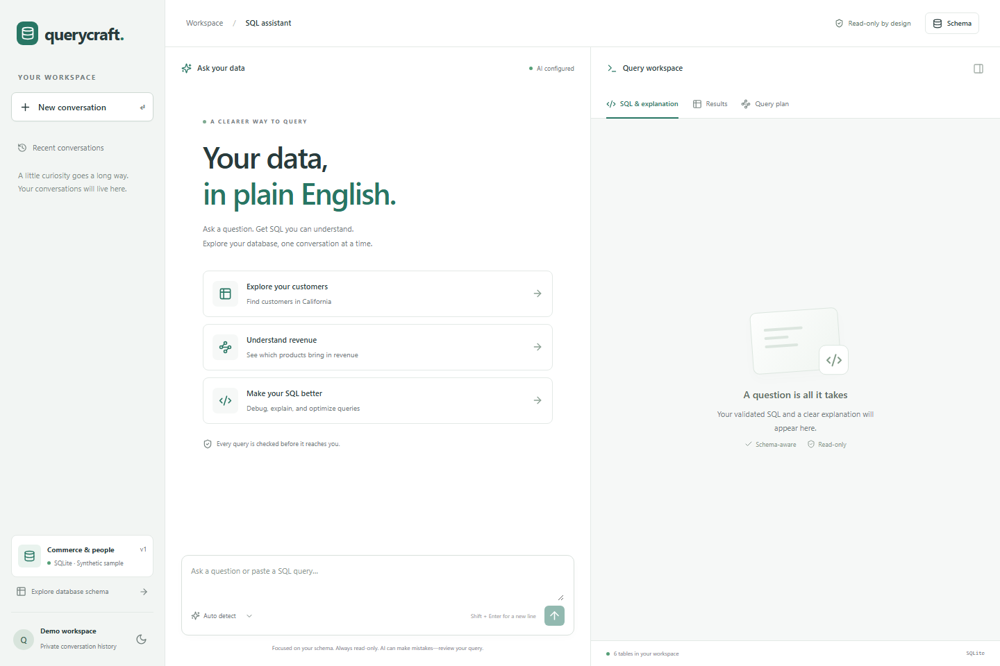

# Querycraft

A focused SQL assistant that turns natural language into validated, read-only SQLite queries. Ask follow-up questions, debug and optimize SQL, inspect query explanations, and explicitly run queries against synthetic sample data.



Built from the approved [specifications](specs/README.md). React + TypeScript, FastAPI, LangGraph, Google Gemini, SQLGlot, and SQLite.

## Run on Windows

Prerequisites: Python 3.12 or 3.13, Node 20.14+ (Node 22 recommended), and a Gemini API key with access to the configured model.

From the project root:

```powershell
python -m venv .venv
.\.venv\Scripts\python.exe -m pip install -r requirements.lock
Copy-Item .env.example .env
npm --prefix frontend ci
npm --prefix frontend run build
.\.venv\Scripts\python.exe data/seed.py
```

Skip copying .env if it already exists. Configure GOOGLE_API_KEY and MODEL_NAME in that file; never commit it. Gemini model availability varies by account. The model must support structured output. The tested model and evaluation results are recorded in [validation](docs/validation.md).

```powershell
.\scripts\start.ps1
```

Open **http://localhost:8000**. Stop with Ctrl+C. No login is required; an opaque browser cookie owns the visitor's separate conversation history. Losing that cookie loses access to the history.

## macOS / Linux

```bash
python3 -m venv .venv
.venv/bin/python -m pip install -r requirements.lock
cp .env.example .env
npm --prefix frontend ci
npm --prefix frontend run build
.venv/bin/python data/seed.py
.venv/bin/python -m uvicorn backend.app.main:app --host 127.0.0.1 --port 8000 --no-proxy-headers
```

Set the two Gemini settings before starting. Do not overwrite an existing .env. Seed creation refuses to overwrite an existing database.

## Docker

```sh
docker compose up --build
```

The image creates the synthetic sample database at build time and runs as a non-root user. Writable application state persists in the named volume. The sample database is separate and read-only. Docker must be installed locally; see the validation report for what was actually tested.

## Configuration

| Variable | Purpose |
| --- | --- |
| GOOGLE_API_KEY | Server-only Gemini credential |
| MODEL_NAME | Available structured-output-capable Gemini model ID |
| MODEL_PROVIDER | google_genai |
| PUBLIC_ORIGIN | Exact browser origin, default http://localhost:8000 |
| SECURE_COOKIES | true behind public HTTPS; false for local HTTP |
| STATE_DIR | Separate application/checkpoint files; default .runtime |
| SAMPLE_DB | Fixed synthetic query database; default data/sample.db |
| DAILY_MODEL_CALLS | Persistent public-demo call ceiling, default 500 |

There is no fallback fake model in the application. Missing configuration returns a clear 503 error. The test adapter exists only in backend/tests and is injected by tests.

Development: run the API, set PUBLIC_ORIGIN=http://localhost:5173, and use npm --prefix frontend run dev. The Vite proxy forwards /api to the backend. For the built app, restore PUBLIC_ORIGIN=http://localhost:8000.

## Try it

- Show customer_id and first_name for all customers.
- Only those from California.
- Show the top five products by revenue in USD.
- Debug this SQL: SELEC customer_id FROM customers
- Optimize this SQL: SELECT o.order_id FROM orders o JOIN customers c ON o.customer_id=c.customer_id
- Employees hired after January 2024 (asks for clarification).
- DELETE FROM customers (refused).
- Who won FIFA? (refused).

Inspect the SQL and explanation, then click **Run query**. Results are capped at 200 rows and 1 MB, with a two-second database deadline. CSV export is the same stored bounded snapshot, expires after one hour, and neutralizes spreadsheet formula text. Query plans are genuine SQLite access plans, not numeric cost estimates.

## Verification

```powershell
.\.venv\Scripts\python.exe -m pytest -q
.\.venv\Scripts\python.exe -m ruff check backend data scripts evals
npm --prefix frontend test
npm --prefix frontend run build
npm --prefix frontend exec -- playwright install chromium
npm --prefix frontend run test:e2e
.\.venv\Scripts\python.exe -m scripts.live_smoke
.\.venv\Scripts\python.exe -m evals.run --runs 3
```

The backend tests use real SQLite and LangGraph with a test-only scripted model. Browser tests start a dedicated test server, not the production server. The smoke test and evaluation runner use the real configured provider and incur API usage. The 60-case evaluation compares query results with hand-authored SQL oracles and varies seed data across runs. Reports go to evals/reports; do not confuse planned thresholds with measured results.

## How it works

See [architecture](docs/architecture.md), [workflow and prompts](docs/workflow.md), [deployment](docs/deployment.md), and [validation](docs/validation.md).

The model proposes SQL. Independent AST checks, schema qualification, declared-relationship validation, and SQLite preparation decide whether it is accepted. A separate connection authorizer and read-only database open enforce the execution boundary. Every transformed query is revalidated.

LangGraph checkpoints keep the last validated query and pending clarification. Refused and failed turns cannot replace the previous query. Ownership checks apply to every conversation, artifact, execution, and download. Requests use origin checks, session-bound CSRF tokens, persisted quotas, bounded model calls, and idempotency keys.

## Data and assumptions

Six synthetic tables: departments, employees, customers, products, orders, order_items. Seed reference date: 2026-10-01. Money is stored in USD cents; historical revenue uses item prices and paid/shipped orders. See [schema](data/schema.sql), [dictionary](data/dictionary.json), and [data spec](specs/03-data-model.md).

The sample schema was missing from the assignment; the user approved this substitute. Follow-up support is treated as mandatory even though the PDF also lists it as a bonus. Index advice is prose, not executable DDL. Ambiguous dates and business metrics require clarification.

Current limitations: SQLite only; single API instance/worker; no user database uploads; no raw token streaming; conservative join support; no enterprise authentication. Syntactically valid SQL can still misunderstand a business question—review explanations and the evaluation evidence.

## Privacy and retention

Questions, recent conversation context, and trusted schema metadata are sent to the configured Gemini model. Query result rows are not sent to the model. Conversations are stored locally/on the configured persistent disk and expire after seven days of inactivity; result data expires after one hour. The API does not log raw questions, results, or credentials. Delete a conversation from the history rail to remove its related data and checkpoints.

## Submission status

Public repository URL and deployed app URL require the user's external account/destination. No placeholder URL is presented as a completed deployment. The deployment configuration is prepared in render.yaml. See [delivery status](docs/delivery-status.md) and the [demo script](docs/demo-script.md) for remaining external deliverables.
