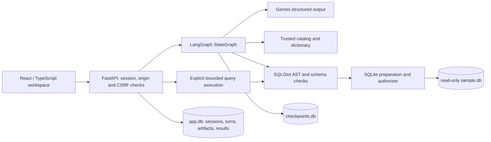

# Architecture

The browser never receives a model credential and never selects a database path or graph thread identifier. Session ownership is checked at every artifact boundary.

The sample query database and writable application state use separate connections/files. The sample is opened using mode=ro, query_only, an operation authorizer, and SQLite resource limits. Trusted provisioning creates the schema once; runtime assistant requests cannot write it.

One API worker is intentional. In-process active-conversation sets coordinate turns, execution, and deletion, while SQLite transactions protect persistent idempotency and quotas. Multiple workers require shared coordination and a database-backed application/checkpoint migration.

Frontend assets and API share an origin. The production image contains a compiled frontend, Python dependencies, and deterministic synthetic data. API paths precede the SPA fallback. No enterprise authentication or arbitrary database connections are implemented.
