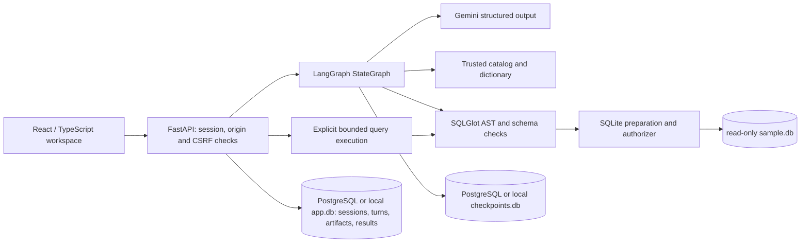

# Architecture

Deployment amendment: on Vercel, Neon PostgreSQL stores application data and LangGraph checkpoints. PostgreSQL advisory locks coordinate mutations across API instances; quotas use serialized transactions. The synthetic query database remains immutable SQLite. Local SQLite state is retained as an alternative. See [Vercel deployment](deployment-vercel.md).

The browser never receives a model credential and never selects a database path or graph thread identifier. Session ownership is checked at every artifact boundary.

The sample query database and writable application state use separate connections/files. The sample is opened using mode=ro, query_only, an operation authorizer, and SQLite resource limits. Trusted provisioning creates the schema once; runtime assistant requests cannot write it.

Local SQLite mode uses one API worker: in-process sets coordinate turns, execution, and deletion, while SQLite transactions protect idempotency and quotas. Vercel uses PostgreSQL advisory locks across instances and durable PostgreSQL application/checkpoint tables. Recovery happens under the conversation lock, so a cold start cannot interrupt another instance. Cleanup runs on incoming session requests in PostgreSQL mode.

Frontend assets and API share an origin. The production image contains a compiled frontend, Python dependencies, and deterministic synthetic data. API paths precede the SPA fallback. No enterprise authentication or arbitrary database connections are implemented.
