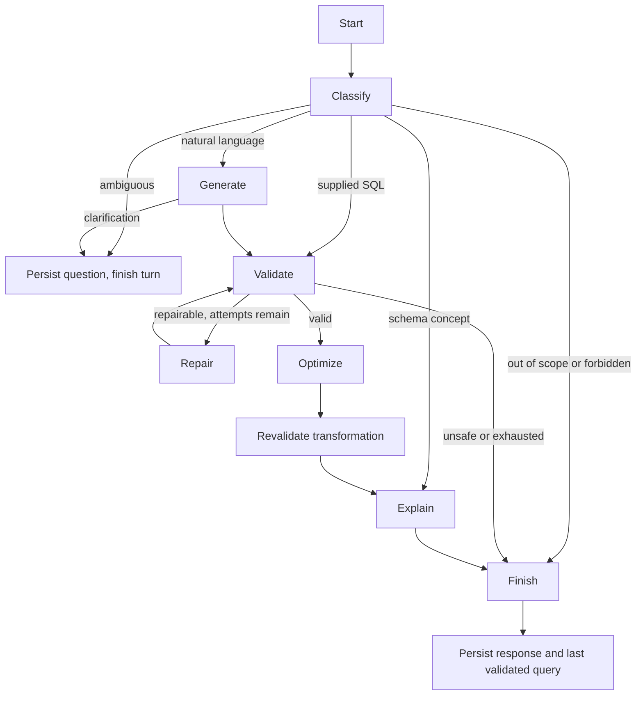

# LangGraph workflow and prompts

The executable graph is in backend/app/agent/graph.py. The provider adapter is in model.py. Prompts live in backend/app/prompts and are loaded from files, not hidden in UI code.

Supplied SQL goes directly to validation, avoiding an unnecessary generation step. Explain requests preserve the submitted query; optimization requests may apply only proven rewrites. Validation is deterministic and independent of the model. Optimization removes only joins whose unique-parent/FK/nullability proof preserves row multiplicity, formats the SQL, and suggests indexes in prose. The final query is validated again. Execution happens through a separate explicit Run request, with fresh validation.

Model calls are capped at eight per turn, repairs at two, and a whole turn at 45 seconds. The final plain-English explanation is structured and checked; if unavailable, the UI honestly labels a structural fallback rather than fabricating a full explanation.

Each owned conversation maps to a persistent LangGraph thread. The last validated query is separate from recent text history. A refusal or failed generation does not replace it. Clarifications end the current turn, store the missing question, and use the next message to resolve it. Restart reconciliation checks final graph state before marking an interrupted request failed.

Prompt inventory:
- policy.txt: scope, trust boundaries, schema-only generation, read-only constraint.
- classify.txt: intent, scope, forbidden operations, ambiguity.
- generate.txt: query generation, context refinement, debugging intent.
- repair.txt: bounded correction using sanitized validator diagnostics.
- optimize.txt: conditional advice without unvalidated SQL or DDL.
- explain.txt: explanation of the exact final query, without invented execution claims.

The public runtime has no mock switch. The scripted provider in backend/tests is only injected by tests. Live evaluation uses Gemini and compares result semantics to SQL oracles.
