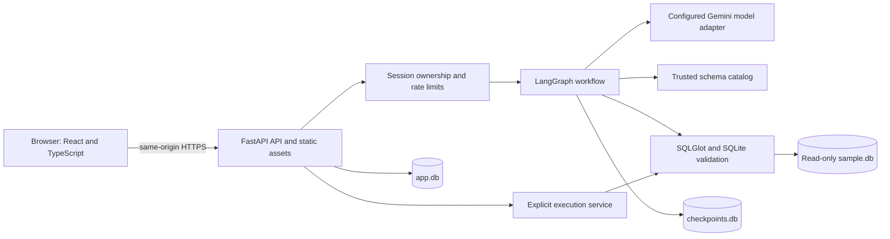

# Architecture and technology decisions

Status: APPROVED. Dependencies will be pinned in lockfiles after approval and compatibility checks; these specifications do not claim an application environment is installed.

## System layout

## Stack rationale

| Layer | Recommendation | Why this fits |
| --- | --- | --- |
| UI | React + TypeScript + Vite | One interactive workspace; no SEO or server-rendering requirement |
| Styling | Tailwind CSS and accessible native controls | Small responsive UI with consistent light/dark styles |
| API | FastAPI + Pydantic on Python 3.12 | Typed request/response validation and direct Python AI integration |
| Orchestration | LangGraph StateGraph | Visible branching, bounded retries, and persistent conversation state |
| Model | Gemini via LangChain's model interface | Structured output integration; isolate provider-specific behavior in one adapter |
| SQL | SQLite + Python sqlite3 + SQLGlot | Reproducible local data, native prepare checks, AST inspection and qualification |
| App state | SQLite application store + database-backed LangGraph saver | Small single-instance demo without a second database service |
| Tests | pytest, Vitest/Testing Library, Playwright | Service, UI, and real-browser acceptance coverage |
| Packaging | Multi-stage Docker build | Reproducible frontend build and Python runtime |

FastAPI documents Pydantic-based validation and OpenAPI integration: [official features](https://fastapi.tiangolo.com/features/). React documents Vite as an option for applications built from scratch, while describing the tradeoffs of owning framework concerns: [React guidance](https://react.dev/learn/build-a-react-app-from-scratch). These choices are our inference from this assignment's narrow application scope.

LangGraph checkpointers preserve state per thread; thread identity must be bound to an owned conversation, not accepted as an unrestricted browser input: [persistence](https://docs.langchain.com/oss/python/langgraph/persistence).

## Alternatives

- Next.js is viable but adds a server framework alongside FastAPI without a current SSR need.
- A Node backend would work, but Python keeps orchestration, validation, and model evaluation together.
- PostgreSQL is preferable for multiple API replicas or heavier writes. SQLite is selected for the sample and single-instance demo. Scaling requires an explicit persistence redesign.
- Streamlit would shorten UI work, but React gives clearer control over the required chat, history, SQL, and results interaction.
- A vector database is unnecessary for six small tables; supply the complete trusted schema to the graph.

## Component boundaries

API handlers manage HTTP, ownership, idempotency, and serialization. Graph nodes manage intent, clarification, generation, repair, and explanation. SQL services implement parsing, semantic validation, approved transformations, and execution. Storage repositories manage sessions, conversations, completed turns, artifacts, and results. No model has a direct database driver, shell, network tool, or filesystem tool.

The schema catalog is built from trusted seed metadata and database introspection at startup. Mismatches fail readiness. Every query artifact carries schema and validator versions plus a hash of its exact SQL. A model response alone cannot mark a query valid.

## Model configuration

Required server settings: MODEL_PROVIDER=google_genai, MODEL_NAME, GOOGLE_API_KEY. Other providers are future adapters, not advertised working integrations. Configure structured schemas, bounded output tokens, provider-supported deterministic settings, and timeouts. Disable provider search/code-execution tools.

Select a currently available model after approval by running the live evaluation described in the acceptance spec. Record the exact provider/model ID and settings in the README/evaluation report. A provider credential is required for genuine model-backed behavior; offline test doubles must never be presented as a live AI deployment.

LangChain documents a standard model interface and structured output; its Google integration documents structured output support: [models](https://docs.langchain.com/oss/python/langchain/models), [Google integration](https://docs.langchain.com/oss/python/integrations/chat/google_generative_ai).

## Runtime and deployment

One service, one API worker, persistent /var/data for app.db and checkpoints.db; immutable sample.db ships in the image outside that writable volume. Local Docker uses a named volume. SQLite runtime connections to the sample use URI mode=ro, query_only, and an authorizer. Application storage connections are separate and never reachable through generated SQL.

Serve the compiled React app and /api/v1 from one origin. Development uses the Vite proxy. Route API paths before SPA fallback; unknown API routes must return JSON 404.

Render with a paid persistent disk is the proposed deployment, subject to the user's hosting choice and budget. Render documents ephemeral default filesystems and paid persistent disks: [disk documentation](https://render.com/docs/disks). Do not claim durable conversation history on ephemeral storage. Hosting price and account access are unresolved; no paid resource is created in the spec phase.

Future scale: migrate application/checkpoint storage to PostgreSQL, replace local locks and quotas with shared coordination, and re-run isolation/concurrency acceptance before adding replicas.
