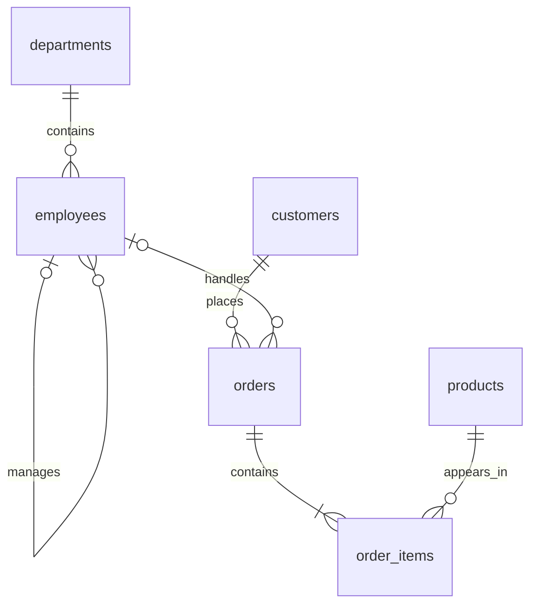

# Sample data and business semantics

Status: APPROVED. User selected a proposed sample schema. All records are synthetic; this is not a representation of an existing customer database.

## Query schema, version demo-v1

Identifiers use snake_case. Adapt the PDF's Employees/HireDate examples to employees/hire_date without changing their meaning.

| Table | Columns and constraints |
| --- | --- |
| departments | department_id INTEGER PK; name TEXT NOT NULL UNIQUE |
| employees | employee_id INTEGER PK; first_name TEXT NOT NULL; last_name TEXT NOT NULL; email TEXT NOT NULL UNIQUE; hire_date TEXT NOT NULL ISO date; department_id INTEGER NOT NULL FK departments; manager_id INTEGER NULL FK employees; salary_cents INTEGER NOT NULL >= 0 |
| customers | customer_id INTEGER PK; first_name TEXT NOT NULL; last_name TEXT NOT NULL; email TEXT NOT NULL UNIQUE; city TEXT NOT NULL; state TEXT NOT NULL two-letter US code; created_at TEXT NOT NULL UTC timestamp |
| products | product_id INTEGER PK; name TEXT NOT NULL; category TEXT NOT NULL; unit_price_cents INTEGER NOT NULL >= 0; active INTEGER NOT NULL in (0,1) |
| orders | order_id INTEGER PK; customer_id INTEGER NOT NULL FK customers; employee_id INTEGER NULL FK employees; order_date TEXT NOT NULL ISO date; status TEXT NOT NULL in (pending, paid, shipped, cancelled) |
| order_items | order_item_id INTEGER PK; order_id INTEGER NOT NULL FK orders; product_id INTEGER NOT NULL FK products; quantity INTEGER NOT NULL > 0; unit_price_cents INTEGER NOT NULL >= 0; UNIQUE(order_id, product_id) |

Foreign keys use the parent *_id key of the same name. No application, checkpoint, metadata, or system table belongs to the model-visible catalog.

Every seeded order has at least one item, enforced by fixture generation/verification rather than claimed as a SQL foreign-key guarantee.

## Semantic dictionary

- Currency: USD. Store integer cents; historical order revenue uses order_items.unit_price_cents, not today's products.unit_price_cents.
- Revenue: SUM(quantity * unit_price_cents) for paid/shipped orders only. Label cents or divide by 100.0 and label USD; never silently mix units.
- Average order value: eligible order revenue divided by distinct eligible order count; guard division by zero.
- Order count: COUNT(DISTINCT orders.order_id) when items are joined.
- “California” maps to state='CA'; display this normalization in assumptions when useful.
- “Customer” includes customers with zero orders unless explicitly restricted.
- “Best customer” is ambiguous; ask whether this means revenue, order count, or another metric.
- ISO dates are compared as dates; timestamps are UTC. Display reference date/time zone for relative-date interpretation. Business-date default: UTC, independent of the developer's local timezone.
- Current month means month start through the next month start, upper bound exclusive. Resolve from a request-scoped clock; tests freeze the clock.
- An explicit follow-up filter replaces a conflicting prior filter for the same attribute unless wording requests a conjunction. Preserve unrelated filters.
- Safe table joins follow declared FK relationships. manager_id joins employee_id for employee/manager queries. Unknown business relationships require clarification.

## Seed and fixture plan

Create a small, explicitly authored oracle fixture for correctness tests and a deterministic larger demo dataset using a fixed seed. Demo targets: 4 departments, 16 employees, 80 customers, 30 products, 200 orders, and at least 400 order_items.

Include employees on 2023-12-31, 2024-01-01, 2024-01-31, and 2024-02-01; customers in CA/NY/TX; customers without orders; nullable employee assignments; managers without reports; inactive products; duplicate display names; cancelled orders; different historical/current prices; multiple items per order; and zero-revenue periods. Include some recent dates relative to a fixed documented dataset reference date; do not silently reseed on every restart.

The small fixture must publish explicit expected row IDs and aggregates. Use several data variants to catch incorrect queries that accidentally pass one fixture. Demo distributions and row counts are checked after seeding.

Provision indexes on foreign keys plus customers.state, employees.hire_date, and orders.order_date. Index advice must inspect existing indexes and avoid duplicate recommendations. Future compound-index suggestions remain explanatory prose.

## Application storage (not queryable by the assistant)

sessions: opaque random cookie-token hash, expiry, created_at.
conversations: UUID, session owner, title, schema_version, created_at, updated_at.
turns: UUID, conversation_id, request_id, status, user text, safe response JSON, timestamps.
query_artifacts: UUID, turn_id, exact validated SQL, hash, schema/validator versions, intent, explanation.
executions: UUID, artifact_id, owner conversation, typed columns/rows JSON, truncation flag, timing, expiry.
checkpoints: LangGraph-managed tables in a separate database; do not hand-design its internal schema.

Unique (conversation_id, request_id) prevents duplicate turns. Persisted turn status reconciles interrupted graph runs; only completed, validated artifacts are executable. Expire anonymous sessions/conversations/checkpoints after seven days of inactivity; expire results after one hour. Cleanup covers all related records. Document loss of access after cookie expiry.
